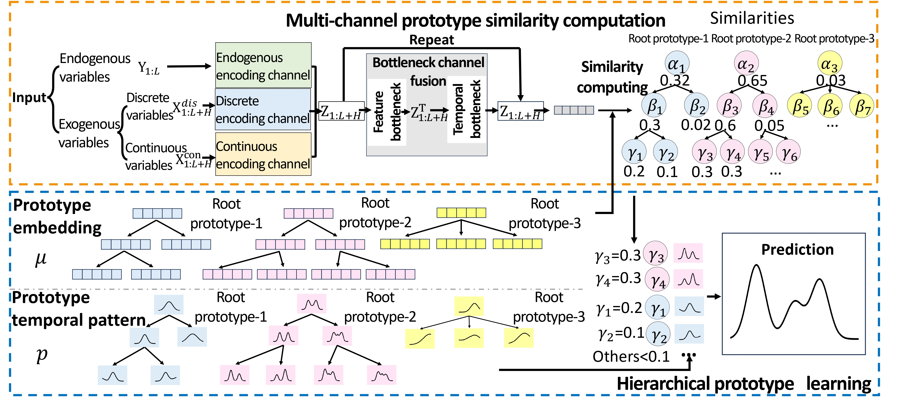

# ProtoTS: Learning Hierarchical Prototypes for Explainable Time Series Forecasting

[](https://arxiv.org/abs/2509.23159)
[](https://iclr.cc/)
[](https://opensource.org/licenses/MIT)

This repository contains the official implementation for the **ICLR 2026** paper: **"ProtoTS: Learning Hierarchical Prototypes for Explainable Time Series Forecasting"**.

---

## 📖 Overview

**ProtoTS** is a novel interpretable forecasting framework that achieves both high accuracy and transparent decision-making through modeling prototypical temporal patterns across hierarchical scales.




## 🛠️ Installation

To set up the environment and install all dependencies, run:

```bash
pip install -r requirements.txt
```

## 🚀 Usage
To train the model or reproduce the experimental results, execute the provided training script:

```bash
bash scripts/train.sh
```

## ✍️ Citation
If you find our work or code useful in your research, please consider citing:

```Code Snippet
@article{peng2025protots,
  title={ProtoTS: Learning Hierarchical Prototypes for Explainable Time Series Forecasting},
  author={Peng, Ziheng and Ren, Shijie and Gu, Xinyue and Yang, Linxiao and Wang, Xiting and Sun, Liang},
  journal={arXiv preprint arXiv:2509.23159},
  year={2025}
}
```